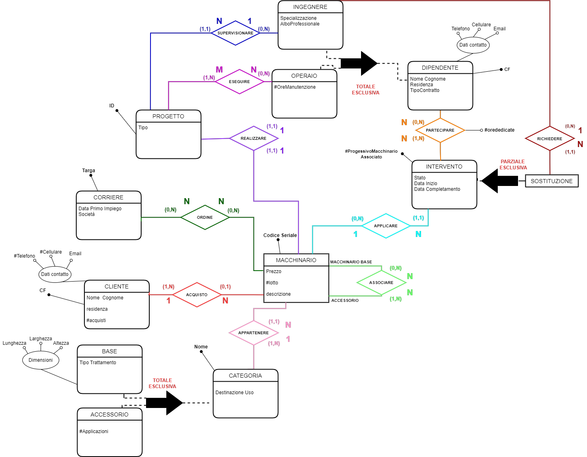
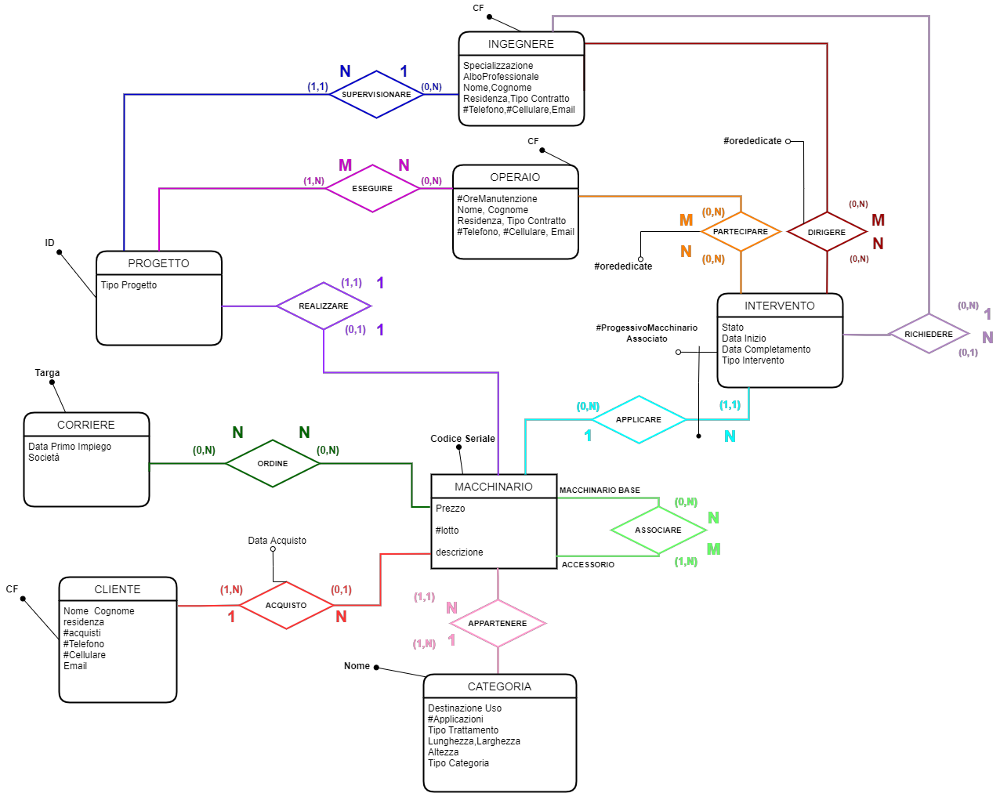
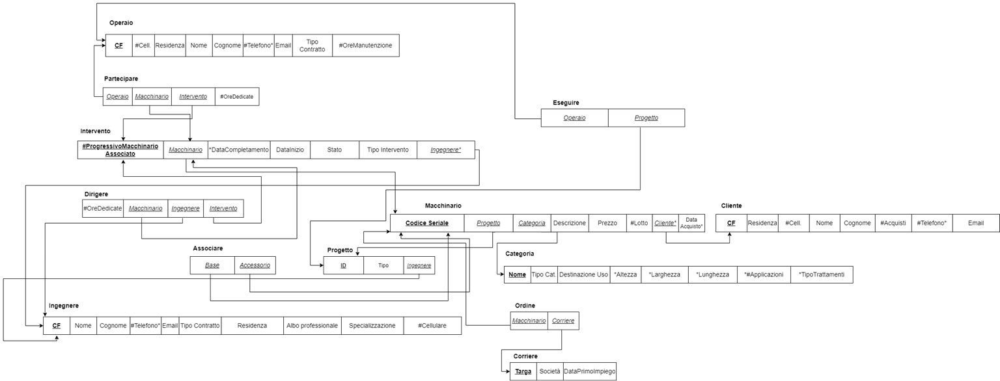

# Gestione Macchinari Estetici – Progetto di Basi di Dati

Progetto del corso di Basi di Dati : progettazione completa di una base di dati per un'azienda che **progetta, produce, vende e ripara macchinari industriali per il settore estetico**, con un'applicazione Java (JDBC) da riga di comando che esegue le operazioni richieste sul database.

Il lavoro copre tutte le fasi della progettazione:

1. **Analisi dei requisiti** – analisi della specifica, dizionari di entità e associazioni, vincoli
2. **Progettazione concettuale** – schema Entità-Relazione
3. **Progettazione logica** – tavola dei volumi e delle operazioni, analisi delle ridondanze, ristrutturazione dello schema E-R, mapping verso il modello relazionale
4. **Implementazione** – script SQL (MySQL) per la creazione dello schema e il popolamento, applicazione Java JDBC

## Il dominio

L'azienda gestisce quattro aree:

- **Progettazione** – ogni macchinario nasce da un *progetto* (prototipale, pilota, collaudato, commercializzato) supervisionato da un ingegnere e a cui partecipano degli operai.
- **Catalogo** – ogni *macchinario* (codice seriale, prezzo, lotto, descrizione) appartiene a una *categoria* di tipo **base** (dimensioni, trattamenti) o **accessorio** (numero di applicazioni); gli accessori possono essere associati a uno o più macchinari base.
- **Vendita** – un *cliente* acquista uno o più macchinari, che vengono affidati a un *corriere* per la consegna.
- **Interventi** – sui macchinari si possono eseguire interventi di **manutenzione** (con operai coinvolti e ore dedicate) o di **sostituzione** (definibili solo da un ingegnere). Ogni intervento ha uno stato: richiesto → valutato → lavorazione → verificato → completato.

### Vincoli non esprimibili nello schema
- Un operaio può essere coinvolto **al massimo in 3 interventi di manutenzione contemporaneamente** (controllato dall'applicazione, operazione 6).
- Un cliente può acquistare più macchinari, ma ogni macchinario può essere acquistato da un solo cliente.

### Scelte progettuali principali
- I dipendenti sono una generalizzazione in **Ingegnere** e **Operaio**, le categorie in **Base** e **Accessorio**, gli interventi in **Manutenzione** e **Sostituzione**; le generalizzazioni sono state eliminate in fase di ristrutturazione.
- Dall'analisi delle ridondanze si è deciso di **mantenere** gli attributi derivati `numOreManutenzione` (Operaio) e `numAcquisti` (Cliente): riducono notevolmente gli accessi per le operazioni di report più frequenti, a fronte di pochi byte di memoria in più. I calcoli sono in [`docs/2_progettazione_logica.pdf`](docs/2_progettazione_logica.pdf).

## Schemi

**Schema E-R**



**Schema E-R ristrutturato**



**Mapping sul modello relazionale**



I file sorgente dei diagrammi sono in [`diagrammi/`](diagrammi/) e si aprono con [draw.io / diagrams.net](https://app.diagrams.net).

## Schema relazionale

Il database `gestioneaziendam.estetica` è composto da 13 tabelle:

| Tabella | Contenuto |
|---|---|
| `macchinario` | macchinari prodotti (codice seriale, prezzo, lotto, progetto, categoria, cliente, data acquisto) |
| `categoria` | categorie base / accessorio con dimensioni, trattamenti, numero di applicazioni |
| `associare` | associazione macchinario base ↔ accessorio |
| `progetto` | progetti con tipo e ingegnere responsabile |
| `ingegnere` | ingegneri (specializzazione, albo professionale, contratto) |
| `operaio` | operai (contratto, ore di manutenzione) |
| `eseguire` | partecipazione degli operai ai progetti |
| `intervento` | interventi di manutenzione/sostituzione con stato e date |
| `partecipare` | operai coinvolti in un intervento e ore dedicate |
| `dirigere` | ingegneri che dirigono un intervento e ore dedicate |
| `cliente` | clienti e numero di acquisti |
| `corriere` | corrieri (targa, società, data primo impiego) |
| `ordine` | macchinari affidati a un corriere |

## Applicazione Java

`src/bdMain/Main.java` è un programma da console che si connette al database tramite JDBC e propone un menu con 15 operazioni:

| # | Operazione |
|---|---|
| 1 | Registrazione di un cliente |
| 2 | Acquisto di un macchinario |
| 3 | Consegna di un macchinario a un corriere |
| 4 | Acquisto di un macchinario di tipo accessorio |
| 5 | Avvio di un intervento di manutenzione |
| 6 | Verifica della possibilità di assegnare un operaio a un intervento di manutenzione |
| 7 | Coinvolgimento di un dipendente in un intervento |
| 8 | Numero di macchinari riparati da ogni dipendente |
| 9 | Macchinari affidati a un corriere o con un intervento "in lavorazione" |
| 10 | Macchinari per i quali non è mai stato richiesto un intervento |
| 11 | Ingegneri con il numero di richieste di sostituzione definite |
| 12 | Ingegneri che non hanno mai progettato macchinari accessori |
| 13 | Report delle categorie accessorio con il numero di macchinari base associati |
| 14 | Report degli operai con le ore totali dedicate alla manutenzione |
| 15 | Report dei clienti con il numero totale di prodotti acquistati |

## Come eseguirlo

### Requisiti
- MySQL 8
- Java 11 o superiore
- [MySQL Connector/J](https://dev.mysql.com/downloads/connector/j/) 8.x (file `.jar`)

### 1. Creare e popolare il database
```bash
mysql -u root -p < sql/01_struttura.sql
mysql -u root -p < sql/02_caricamento_dati.sql
```
(in alternativa si possono aprire ed eseguire i due script da MySQL Workbench, nell'ordine)

### 2. Compilare e avviare l'applicazione
Le credenziali si passano con variabili d'ambiente (`DB_USER` vale `root` se non impostata, `DB_URL` punta già al database locale):

```bash
export DB_USER=root
export DB_PASSWORD=la_tua_password

javac -encoding UTF-8 -d out src/bdMain/Main.java
java -cp "out:mysql-connector-j-8.x.x.jar" bdMain.Main
```
Su Windows il separatore del classpath è `;` invece di `:`.

## Struttura della repository

```
├── README.md
├── sql/
│   ├── 01_struttura.sql             # creazione database e tabelle
│   └── 02_caricamento_dati.sql      # popolamento con dati di esempio
├── src/bdMain/Main.java             # applicazione JDBC
├── docs/
│   ├── 1_progettazione_concettuale.pdf  # requisiti, dizionari, vincoli, schema E-R
│   ├── 2_progettazione_logica.pdf       # volumi, operazioni, ridondanze, ristrutturazione, mapping
│   └── img/                             # immagini degli schemi
└── diagrammi/                       # sorgenti draw.io degli schemi
```

## Autori
- **Antonio Nappi**
- **Giuseppe Basile**
